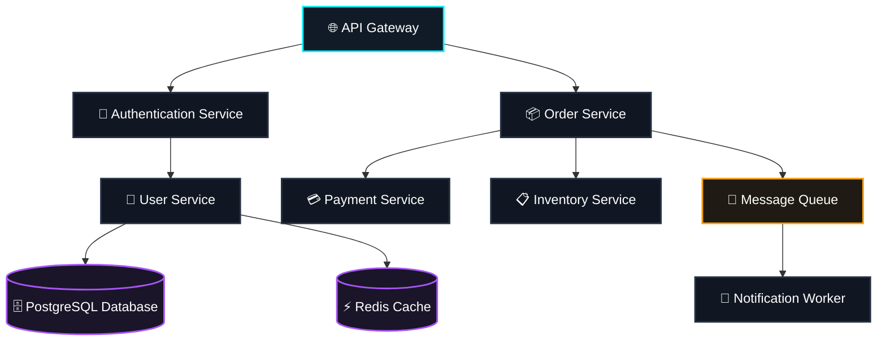

# 👾 BugTown — A Living Software Bug Simulator

<p align="center">
  
  
  
  
  
  
</p>

<p align="center">
  <b>A miniature distributed system observability platform, interactive chaos engineering laboratory, and living simulation game.</b><br/>
  Watch microservices communicate via animated SVG traffic packets, observe failures cascade through caller dependencies, and track software bugs as living digital organisms that crawl along dependency edges until contained or resolved by verified architectural resilience strategies.
</p>

---

## 🌟 Highlights

- **🧬 Living Bug Organisms**: Software bugs (`BUG-####`) behave like living entities with taxonomy, impact scores, severity levels, and lineage histories that propagate along upstream dependency edges.
- **⚡ Authoritative OTP Simulation**: Supervised GenServers (`BugTown.Engine.Coordinator`) coordinate real-time clock ticks, fault progression, and distributed waterfall traces, broadcasting updates at 800ms intervals via Phoenix PubSub.
- **🗺️ Interactive Living Topology**: 10 microservices and 11 dependency links rendered with real-time SVG packet animation, connection latency glow, and node health indicators.
- **💥 Chaos Engineering Console**: Inject 6 core fault types (*Memory Leak*, *Race Condition*, *Service Crash*, *Network Latency*, *Packet Loss*, *Database Outage*) across any node or link.
- **🧪 8 Deterministic Scenarios**: Run repeatable chaos experiments (*Cascading Payment Failure*, *Cache Eviction Thundering Herd*, *Database Connection Starvation*, etc.) with side-by-side metric comparison and snapshot saving to PostgreSQL.
- **🛡️ 11 Architectural Recovery Strategies**: Test real resilience mechanisms (*Circuit Breakers*, *Token Bucket Rate Limiting*, *Failover Replicas*, *Thread Pool Scaling*, *Cache Warming*, *Pod Restarts*) and observe their empirical effect on system metrics.
- **📊 Production-Grade Observability**: Time-series sparklines (Throughput, Latency, Error Rate, Availability, CPU, Memory), structured log stream with instant filtering, and **Distributed Trace Waterfall Viewer** with microsecond span timing.
- **🌌 Developer Mission-Control UI**: Dark theme aesthetic (`#080B12` midnight background, `#111722` elevated panels, `#00F0FF` electric cyan accents, technical grid pattern).

---

## 🏗️ System Architecture



### Distributed Services (10 Nodes, 11 Dependencies)
1. **API Gateway** (`gateway`) — Edge ingress, SSL termination, and routing.
2. **Authentication Service** (`service`) — Token verification, OAuth2, and session checks.
3. **User Service** (`service`) — Profile management, permissions, and identity data.
4. **Order Service** (`service`) — Checkout orchestration and cart fulfillment.
5. **Payment Service** (`service`) — Transaction authorization, settlement, and fraud detection.
6. **Inventory Service** (`service`) — Stock reservations and warehouse allocations.
7. **Notification Worker** (`worker`) — Asynchronous SMS, email, and webhook notifications.
8. **Redis Cache** (`cache`) — Hot session cache and query acceleration.
9. **PostgreSQL Database** (`database`) — Primary relational transactional storage.
10. **Message Queue** (`queue`) — Event streaming bus decoupling asynchronous workflows.

---

## 🧬 Bugs as Living Entities

Bugs in BugTown are not static badges or decorative alert icons. They are stateful, biological entities that:
- Have a unique identity (`BUG-####`) and biological species:
  - 🧠 `memory_hog`: Progressively devours heap memory until out-of-memory crash.
  - ⚡ `race_demon`: Causes thread collisions and concurrent data inconsistency.
  - 💥 `crash_worm`: Triggers process panics and unhandled exceptions.
  - ⏳ `latency_parasite`: Attaches to dependency links, inflating latency and starving caller pools.
  - 👻 `packet_phantom`: Induces dropped packets and retry amplification storms.
  - 🗄️ `db_gremlin`: Locks tables, exhausts connection pools, and starves readers.
- Progress through realistic lifecycles: `spawned` → `propagating` → `active` → `contained` → `resolved`.
- Track their lineage and propagation path across the service topology.
- Dynamically spawn secondary symptoms when overloaded services exceed critical degradation thresholds.

---

## 🖥️ Application Navigation

| Page | URL | Purpose |
| :--- | :--- | :--- |
| **Command Center** | `/` | Real-time mission control: live SVG topology, animated traffic packets, living bug organisms, quick fault injection, incident feed, and event timeline. |
| **Topology Explorer** | `/topology` | Interactive dependency graph with zoom/pan, category filters, and detailed node inspector (live CPU, memory, RPS, latency, fault counts). |
| **Fault Lab** | `/faults` | Chaos engineering console for injecting all 6 fault types with custom severity, delay, and duration. |
| **Incidents** | `/incidents` | Incident register with status tabs (*All*, *Active*, *Investigating*, *Resolved*), root-cause analysis, timeline log, and one-click incident acknowledgement. |
| **Observability** | `/observability` | Real-time multi-metric sparklines (Throughput, Latency, Errors, Availability, CPU, Memory), structured log stream with instant search, and **Distributed Trace Waterfall Viewer**. |
| **Experiments** | `/experiments` | 8 pre-configured deterministic chaos scenarios with execution controls, database snapshot persistence, and side-by-side metric delta comparison. |
| **Recovery Center** | `/recovery` | Resilience strategy catalog (Circuit Breakers, Rate Limiting, Failover, Pod Restarts, Cache Warming, etc.), active shield registry, and remediation audit trail. |
| **Settings** | `/settings` | Simulation engine clock rate (0.25x – 4x), critical SLO threshold tuners, cluster reset, and configuration. |

---

## 🚀 Quickstart

### Prerequisites
- **Elixir** (1.17+ or 1.20+) & **Erlang/OTP** (27+)
- **PostgreSQL** (14+) running locally or via Docker
- **Node.js** (optional: assets are built with esbuild & tailwind standalone)

### 1. Start PostgreSQL

Using the included Docker Compose setup:
```bash
docker compose up -d
```
Or use a local PostgreSQL server on `localhost:5432` (default credentials: `postgres:postgres`).

### 2. Install Dependencies & Setup Database
```bash
mix deps.get
mix ecto.setup
```
*(Creates development database, runs migrations, and seeds the 10 services, 11 dependencies, and baseline experiments)*

### 3. Build Client Assets
```bash
mix assets.build
```

### 4. Start the Phoenix Server
```bash
mix phx.server
```
Visit **[`http://localhost:4000`](http://localhost:4000)** in your browser.

---

## 🧪 Testing & Code Quality

Run the automated ExUnit test suite:
```bash
mix test
```

Run comprehensive precommit checks (warnings-as-errors, formatting check, unused dependency unlock, and test verification):
```bash
mix precommit
```

---

## 📁 Repository Structure

```
BugTown/
├── .github/
│   └── workflows/
│       └── ci.yml               # GitHub Actions CI workflow
├── assets/
│   ├── css/
│   │   └── app.css              # Dark developer-focused Tailwind v4 theme
│   └── js/
│       └── app.js               # Phoenix LiveSocket client
├── config/
│   ├── config.exs               # General application configuration
│   ├── dev.exs                  # Development configuration (supports PG env vars)
│   ├── prod.exs                 # Production release configuration
│   ├── runtime.exs              # Runtime environment variables
│   └── test.exs                 # Test sandbox configuration
├── docker-compose.yml           # PostgreSQL 16 container definition
├── lib/
│   ├── bug_town/
│   │   ├── application.ex       # OTP Application supervisor tree
│   │   ├── bugs/                # Living bug entities schema and context
│   │   ├── engine/              # Authoritative simulation engine
│   │   │   ├── bug_propagator.ex    # Bug lifecycle and cascade evaluator
│   │   │   ├── coordinator.ex       # Main simulation GenServer (ticks, pubsub, rpc)
│   │   │   ├── fault_evaluator.ex   # Fault physics and resource degradation
│   │   │   ├── incident_manager.ex  # SLO monitor, deduplication, and events
│   │   │   ├── scenarios.ex         # 8 deterministic chaos scenarios
│   │   │   ├── state.ex             # Pure immutable simulation state struct
│   │   │   └── traffic_simulator.ex # Animated SVG packet routing & trace waterfall
│   │   ├── experiments/         # Experiment persistence schemas
│   │   ├── faults/              # Chaos fault injection schemas
│   │   ├── incidents/           # Incident and timeline schemas
│   │   ├── observability/       # Metrics, logs, traces, and spans
│   │   ├── recoveries/          # Architectural recovery strategies
│   │   ├── repo.ex              # Ecto Repo
│   │   └── topology/            # Services and dependency links schemas
│   └── bug_town_web/
│       ├── components/          # Core HEEx components and Layouts.app shell
│       ├── endpoint.ex          # Phoenix HTTP & WebSocket endpoint
│       ├── live/                # All 8 Phoenix LiveViews
│       └── router.ex            # Authenticated LiveView routes
├── priv/
│   ├── repo/
│   │   ├── migrations/          # Ecto PostgreSQL migrations
│   │   └── seeds.exs            # 10 microservices, 11 dependencies & baseline data
│   └── static/                  # Static assets & favicon
└── test/                        # ExUnit unit, engine, and LiveView integration tests
```

---

## ⚙️ Environment Variables

Optional environment variables for custom environments:

| Variable | Default | Description |
| :--- | :--- | :--- |
| `PGUSER` | `postgres` | PostgreSQL username |
| `PGPASSWORD` | `postgres` | PostgreSQL password |
| `PGHOST` | `localhost` | PostgreSQL host address |
| `PGPORT` | `5432` | PostgreSQL port |
| `PORT` | `4000` | HTTP web server port |
| `DATABASE_URL` | — | Full database connection URI (in `prod` mode) |
| `SECRET_KEY_BASE` | — | Secret key base for sessions and cookies (in `prod` mode) |

See [`.env.example`](.env.example) for a quick template.

---

## 📜 License

This project is open-source software licensed under the [MIT License](LICENSE).
